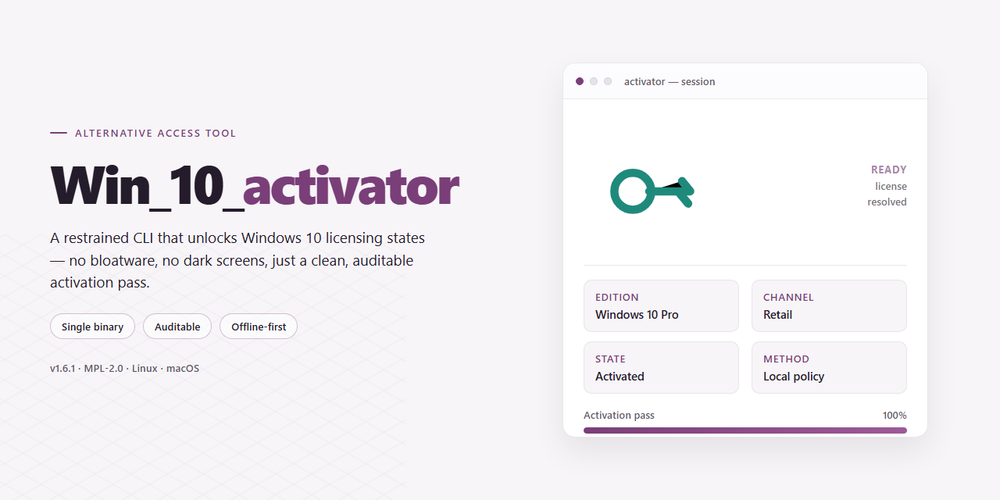

# 🛠 Alternative Access Tool for Windows 10 & 11

### 💻 PowerShell Installer

   

---

A script collection that automates activation of Microsoft products on Windows 10 using openly available source code. The tool deploys scripts that apply publicly documented keys for each Windows edition and then establish authentication against a configurable list of KMS servers. Each script executes with elevated privileges to ensure the activation workflow completes without permission interruptions. The implementation keeps the entire process transparent and script-driven, making it straightforward to inspect, adjust, and rerun across different system configurations.

## 📋 System Requirements

- **PowerShell 5.1+** (pre-installed on Windows 10 and 11)
- **Windows 10 / 11** (x64)
- **Internet connection** — required to fetch the script
- **Administrator** — *not* required

## Features

- **Broad version coverage** — key selection spans the full Windows 10 edition lineup, including Home, Professional, Enterprise, and Education, so the correct activation path is chosen for the installed SKU rather than relying on a single generic key.

- **KMS-based activation flow** — each script stages the appropriate product key, requests activation against configured KMS endpoints, and reports the resulting licensing status back to the console.

- **Multiple server fallback** — activation attempts iterate across a list of KMS hosts, retrying against the next endpoint when one is unreachable or returns an unsuccessful response, which reduces failures caused by a single unavailable server.

- **Script-driven and auditable** — the logic lives in readable batch scripts, so every step (key installation, endpoint selection, activation call, status check) can be inspected and modified without reverse-engineering a compiled binary.

- **Open source foundation** — all activation logic is built on publicly available open source code, allowing review, contribution, and adaptation to new builds or editions as they appear.

- **Administrator-scoped execution** — scripts are designed to run elevated, matching the privilege level required by the underlying licensing operations and avoiding partial or silently failed runs.

- **Lightweight footprint** — no background services, drivers, or persistent agents are installed; execution is a discrete, one-shot operation with no runtime overhead afterward.

- **Status verification built in** — each run concludes with a licensing query so the outcome is confirmed rather than assumed, giving a clear pass/fail signal per attempt.

## How it works

The script operates by pairing each Windows 10 edition with its corresponding public KMS client key, then registering that key against the local licensing service. Once the key is installed, the script cycles through a curated list of KMS endpoints, attempting authentication against each in turn until the licensing subsystem reports a successful activation state.

All operations run through the native software licensing management tooling already present on the system, so no external binaries are introduced. The script checks the current edition and activation status first, selects the matching key path, and only proceeds when the detected configuration supports it — avoiding redundant or mismatched operations.

Each step is logged to the console so the outcome of every key installation and endpoint attempt is visible as it happens. If an endpoint is unreachable or rejects the request, the script moves to the next candidate without interrupting the run. The process completes once a valid activation response is recorded, and the final status is queried directly from the licensing service to confirm the result.

## Compatibility

Win_10_activator targets Microsoft Windows 10 across the Home, Professional, Enterprise, and Education editions, and it is built to run on both x86 and x64 installations. The scripts assume a standard Windows environment with administrative privileges available, since elevation is required to modify licensing state and register the KMS client configuration.

The tooling depends only on components shipped with Windows itself — the built-in scripting host and the native licensing management utilities — so no additional runtimes, package managers, or external dependencies need to be present. This keeps the footprint minimal and avoids conflicts with existing software on the host.

Because activation is performed through the operating system's own licensing interface, the scripts remain compatible with systems that have received cumulative updates and feature upgrades, provided the underlying licensing services are intact and not disabled by policy. Environments where software protection services have been modified or restricted by group policy may require those services to be restored before the scripts can complete successfully.

The collection is intended for use on systems where the operator holds the appropriate rights to manage licensing, and it does not interfere with network configuration, installed applications, or user data. Each script is self-contained and can be reviewed before execution, allowing verification of the exact commands issued against the licensing subsystem.

## Configuration

The activator reads its settings from a `config.ini` file located in the same directory as the launcher. On first run, if the file is absent, the script generates it with defaults that target the current Windows edition. Values are parsed at startup, so editing the file requires re-running the launcher for changes to take effect.

### Key options

| Key | Default | Description |
|-----|---------|-------------|
| `edition` | `auto` | Target product edition. `auto` detects the installed SKU; otherwise accepts `home`, `pro`, `enterprise`, or `education`. |
| `server` | `auto` | KMS endpoint selection. `auto` rotates through the internal list; a literal hostname pins the script to a single server. |
| `retries` | `3` | Number of activation attempts per server before moving to the next candidate. |
| `timeout` | `30` | Seconds to wait for a server response before marking it unreachable. |
| `verbose` | `0` | Set to `1` to print each step of the activation sequence to the console. |

### Edition detection

When `edition=auto`, the script queries the Windows product type through the scripting runtime and maps the result to the matching key set. Explicit values bypass detection and force a specific key family. An unrecognised value causes the launcher to fall back to `auto` and log a warning.

### Server selection

The `server` option accepts either `auto` or a single hostname. In `auto` mode, the script iterates the embedded server list in order, skipping any endpoint that exceeds `timeout` or returns a non-success status, and stops at the first successful activation. Hostnames are matched case-insensitively, and trailing whitespace is trimmed during parsing.

### Logging and exit codes

Activation output is written to `activation.log` beside the configuration file. Verbose mode mirrors the same lines to stdout. The launcher exits with `0` on success, `1` when all candidate servers are exhausted, and `2` for configuration or detection errors, allowing the script to be driven from other tooling.

## FAQ

**Is this tool safe to run?**
The scripts are open source and fully auditable. Each file contains only the logic needed to install the appropriate key and reach a KMS endpoint; there are no bundled binaries, obfuscated payloads, or hidden network calls beyond the activation traffic itself. Review every script before execution — that is the point of publishing them openly.

**Which product editions are covered?**
The key set spans the standard Windows 10 editions (Home, Professional, Enterprise, Education) plus matching Microsoft Office volume releases. Edition detection is automatic, but the configuration section lets you pin a specific key if your SKU is misreported.

**Why does activation fail on my machine?**
The usual causes are a mismatched key for the installed edition, an unreachable KMS endpoint, or a pre-existing activation state that needs clearing first. Run the script from an elevated prompt and check that the target host responds on port 1688. If a previous key is still resident, clear it before retrying.

**How does the script choose a KMS host?**
It iterates through the embedded server list and stops at the first one that answers correctly. You can reorder or replace entries in the configuration file to prefer a host on your own network.

**Does this require an internet connection?**
Only for reaching the KMS endpoint. If your organization runs an internal KMS, point the configuration at it and the script will never touch an external address.

**Will this survive a Windows feature update?**
Major upgrades can reset the licensing state. Re-running the script after an update restores activation; no reconfiguration is needed since the same key set applies.

**Can I use this on a domain-joined machine?**
Yes, but group policy may override local activation settings. Verify that your environment does not enforce a conflicting KMS or AD-based activation scheme before running.

**How do I verify activation succeeded?**
Check the licensing status from an elevated prompt after the script completes. A licensed status confirms the key installed and the endpoint responded; anything else means the log will show which step failed.

**Is there any telemetry or logging sent elsewhere?**
No. Output is written locally so you can inspect exactly what the script did. Nothing is transmitted beyond the activation request to the selected KMS host.

**Can I contribute additional keys or hosts?**
Yes. The project is structured so key lists and host lists are plain data files. Submit additions through the normal contribution workflow with a note on which edition and region they cover.

## Disclaimer

This collection of scripts is provided strictly for educational and research purposes, intended to demonstrate how open source activation mechanisms function in controlled environments. The code is offered as-is, without any warranty or guarantee of fitness for a particular purpose, and the maintainers accept no liability for how it is used or for any outcomes resulting from its execution. Users are solely responsible for ensuring their use of these scripts complies with all applicable laws, regulations, and licensing terms governing the software they interact with. Activation methods described here are not a substitute for proper licensing, and running any script against a system you do not own or administer without explicit authorization is outside the intended scope of this project. No support, endorsement, or assurance of legality is implied or provided; proceed only if you fully understand the technical behavior of the scripts and accept complete responsibility for the results.